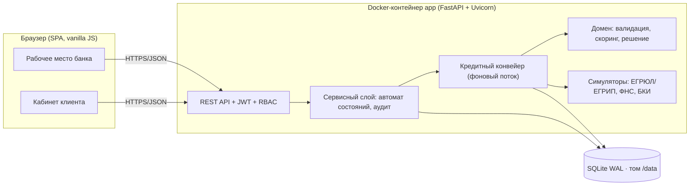
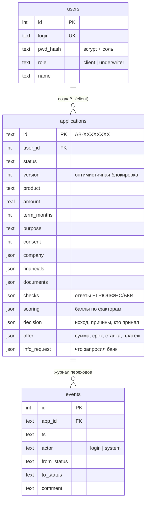

# Архитектура и продуктовые решения

## 1. Исследование: что нужно клиенту и банку (JTBD → решение)

| Кто | Задача (JTBD) | Боль | Что сделано в MVP |
|---|---|---|---|
| Предприниматель (не банкир) | «Когда не хватает оборотки, хочу быстро понять, какой кредит мне подходит и дадут ли его» | Не знает продуктов; повторный ввод данных; непонятно, что с заявкой | Выбор из 3 продуктов с лимитами, расчёт платежа «на лету», автоподстановка данных компании по ИНН, мастер из 5 шагов с сохранением черновика, живой статус и лента событий |
| Предприниматель | «Хочу знать, что делать дальше» | Отказ без причин, запросы документов «в никуда» | Понятные причины решения, запрос информации внутри продукта с возвратом в ту же заявку, встречное предложение вместо бинарного отказа |
| Андеррайтер | «Хочу тратить время только на нестандартные заявки» | Ручная сверка источников, непрозрачная оценка | Авто-решение для чётких случаев, очередь только «серой зоны» и крупных сумм, все данные источников и разбор скоринга по факторам на одном экране |
| Банк | «Управлять процессом в едином продукте» | Разрозненные системы | Единый автомат состояний, журнал аудита каждого перехода, статистика очереди |

**Граница MVP (что вошло и почему):** подача заявки → валидация → обогащение (ЕГРЮЛ/ЕГРИП, ФНС, БКИ — симуляторы) → скоринг → кредитное решение → ручное рассмотрение → оферта → подписание → выдача (симуляция). Не вошло: залог, поручительство, реальная ЭП, графики досрочного погашения, мультикомпанийные кабинеты — они не меняют сквозной путь и описаны в разделе «Развитие».

## 2. Архитектура

**Слои:** `main.py` (HTTP, авторизация, DTO) → `service.py` (единая точка смены статуса `transition`, конвейер) → `domain.py` (чистые функции, без I/O — легко тестировать) → `db.py` (хранилище) ; `integrations.py` — симуляторы за теми же функциями, что были бы у реальных адаптеров.

**Как конвейер связывает клиента и банк.** `POST /submit` переводит заявку в `SUBMITTED` и запускает фоновый конвейер; каждый этап — отдельная транзакция со сменой статуса, событием аудита и увеличением `version`. UI опрашивает API раз в 2 с и показывает текущий этап. Заявки, застрявшие на автоматических этапах при перезапуске, автоматически продолжаются (`resume_pending`).

## 3. Модель данных

## 4. Автомат состояний

См. [state-diagram.md](state-diagram.md) (генерируется из кода). Недопустимый переход → `409`. Клиент может действовать только в `DRAFT`, `INFO_REQUESTED`, `OFFER_READY`, `SIGNING`; андеррайтер — только в `MANUAL_REVIEW`.

## 5. Модель кредитного решения

**Скоринг** (`points-v1`) — балльная модель: база 500 ± вклад 9 факторов (возраст бизнеса, рентабельность, долговая нагрузка, длина КИ, текущая просрочка, максимальная просрочка 12 мес., налоговая задолженность, риск-флаги ФНС, сумма к выручке). Класс риска: A ≥ 700, B ≥ 600, C ≥ 500, D < 500. Разбор факторов виден андеррайтеру.

**Кредитное решение** (отдельно от скоринга, правила применяются сверху вниз):

| № | Условие | Исход |
|---|---|---|
| 1 | Компания не ACTIVE / дисквалификация / просрочка > 90 дн. | Отказ (жёсткий стоп) |
| 2 | Скоринг < 450 | Отказ |
| 3 | Допустимый платёж ≤ 0 (50 % прибыли/12 − текущие платежи) | Отказ |
| 4 | Платёж по заявке > допустимого | **Встречное предложение** (меньшая сумма, шаг 10 000 ₽); если < минимума продукта — отказ |
| 5 | Скоринг ≥ 650 и сумма ≤ 3 млн ₽ | Одобрение |
| 6 | Иначе (серая зона 450–649 или сумма > 3 млн) | Ручное рассмотрение |

Валидация перед конвейером: поля, лимиты продукта, контрольная сумма ИНН, согласие; для суммы > 1,5 млн ₽ — бухгалтерская отчётность. Ставка = базовая ставка продукта + надбавка класса риска (A 0, B +2, C +4, D +7 п.п.). Андеррайтер может одобрить, изменить условия, запросить информацию или отказать (комментарий обязателен).

## 6. Enterprise-ориентированность

| Аспект | Реализация |
|---|---|
| Безопасность | JWT с TTL, RBAC (клиент видит только свои заявки; скоринг и сырые ответы БКИ скрыты от клиента — минимизация данных), пароли scrypt, ограничение попыток входа, security-заголовки, экранирование всего пользовательского вывода в UI, контейнер без root, `read_only`, `cap_drop: ALL` |
| Надёжность | Транзакционные переходы, оптимистичная блокировка (`version` → 409), возобновление конвейера после рестарта, `/health`, healthcheck в Docker |
| Аудит | Таблица `events`: кто, когда, из какого статуса в какой и почему |
| Воспроизводимость | Зафиксированные версии (`requirements.txt`), Docker, CI, синтетические данные, детерминированные симуляторы |
| Сопровождение | Чистый домен без I/O, e2e-тесты, OpenAPI из кода, документация генерируется (`scripts/gen_docs.py`) |

## 7. Ограничения и развитие

* SQLite и один воркер — достаточно для демо. Для продакшена: PostgreSQL (схема переносима; хранение JSON → `JSONB`), конвейер → очередь задач (Celery/Kafka) с идемпотентными шагами, горизонтальное масштабирование API.
* Секреты → Vault/KMS, JWT → OIDC банка, ротация ключей; `JWT_SECRET` в демо задаётся переменной окружения.
* Симуляторы → адаптеры к СМЭВ/ФНС/БКИ с таймаутами, ретраями и circuit breaker (интерфейс функций сохранён).
* Скоринг: калибровка на данных, мониторинг дискриминирующей способности и стабильности, версионирование моделей (`scoring.model`).
* Реальные загрузка и OCR документов, электронная подпись, платёжный шлюз для выдачи.
